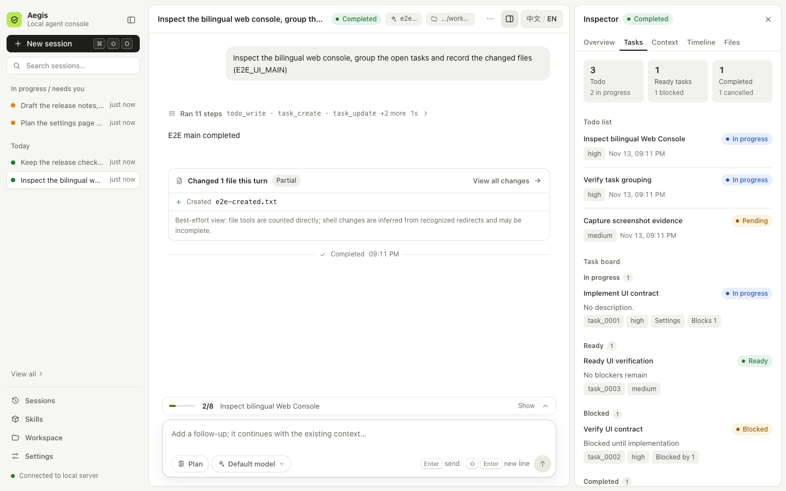

# Aegis Agent

`aegis-agent` is a Web-first local agent harness written in Go. You drive it
from a bilingual local Web console; the CLI remains available for automation,
recovery, CI, and advanced use.

The model remains the agent. Aegis supplies provider adapters, tools, skills,
durable session facts, compaction, live steering, and safety boundaries without
imposing a fixed workflow engine.

[Quick start](#quick-start) · [Web console](#web-console) ·
[Provider configuration](#provider-configuration) ·
[Runtime architecture](./spec/01-runtime-architecture.md) ·
[Web console spec](./spec/17-web-console.md) · [Security](./SECURITY.md) ·
[Contributing](./CONTRIBUTING.md)

> **Status:** active development (`v0.1.0-dev`). The Web-first v1 surface is
> usable; advanced orchestration and isolation remain explicit/experimental.



## Highlights

- **Local Web console** — chat-first session workspace with a searchable
  session sidebar, collapsible tool steps, live activity, inline Plan Mode
  approvals and questions, Goal controls, a contextual inspector (tasks,
  children, context, timeline, file changes), a command palette, and provider
  settings. Simplified Chinese by default, English one click away.
- **CLI fallback** — `init`, `run`, `exec`, `steer`, `continue`, `sessions`,
  `goal`, `tasks`, `probe-provider`, and `doctor`.
- **Provider adapters** — OpenAI Responses, Anthropic Messages, Google Gemini
  `generateContent`, and OpenAI-compatible Responses endpoints.
- **Durable, local facts** — messages, events, state, goals, tasks, queue jobs,
  and compaction artifacts stay in files you own and can recover from.
- **Safety boundaries** — workspace and symlink escape protection, shell
  timeouts and environment allowlists, Plan Mode gates, and audited Web
  mutations.
- Optional, default-off local [browser-use tools](./spec/19-browser-tools.md).

Aegis deliberately does not provide a hosted multi-user service, browser IDE
features, remote terminals, or a fixed workflow engine.

## Quick start

Requirements: Go 1.26.10+ on Linux, macOS, or WSL.

```sh
./build.sh
./bin/aegis-agent init --force
export OPENAI_API_KEY=...        # or the key your provider profile names
./bin/aegis-agent web --config .aegis-agent/config.yaml --listen 127.0.0.1:3940
```

Open `http://127.0.0.1:3940`. Sessions use the local `workspace/` directory by
default, which Git ignores.

`init` writes a configuration file; select it explicitly with `--config`. A
missing explicitly selected config is an error, never a silent fallback, and
generating one does not authorize implicit workspace config loading (see
[configuration loading](./spec/02-cli-and-config.md#7-配置文件)). Without any
loaded config, new runs, provider probes and Web startup require an explicit
`--allow-builtin-config`. Run `doctor --config … --skip-probe` to diagnose a
setup without calling a provider.

## Web console

The console is a no-build ES module app embedded in the binary
(`internal/webconsole/ui`). It needs no CDN or npm runtime and works offline.

- **Sidebar** — new session, search, and your sessions: running and waiting
  sessions are pinned, the rest are grouped by date. Session pages, Skills,
  Workspace and Settings live at the bottom.
- **Session** — the conversation reads top to bottom: tool calls fold into step
  groups, a live line shows what the agent is doing, and plan approvals or
  questions appear inline where you can answer them. The composer starts,
  steers, continues or stops the run; toggle **Goal** or **Plan** before
  sending. Failed sends are kept as drafts you can restore — nothing is resent
  automatically.
- **Inspector** — opens beside the conversation on wide screens (overlay on
  smaller ones) with only the tabs that apply: overview, plan, goal, tasks,
  agents, context, timeline and files.
- Every session has its own URL (`/s/<session-id>`), so reloads and the browser
  back button work as expected.

| Shortcut (macOS / others) | Action |
| --- | --- |
| `⌘K` / `Ctrl+K` | Command palette (actions, pages, recent sessions) |
| `⌘⇧O` / `Ctrl+Shift+O` | New session |
| `⌘B` / `Ctrl+B` | Toggle the sidebar |
| `⌘.` / `Ctrl+.` | Toggle the inspector |
| `/` | Focus the composer |
| `?` | Show all shortcuts |
| `Enter` / `Shift+Enter` | Send / new line |

The console uses a light theme and starts in Simplified Chinese; switch with
`中文 / EN` in the top bar (stored in the browser). Prompts, model output, tool
payloads, file contents and paths are always shown verbatim, never translated.

**Keep the console on loopback unless the network is trusted.** It can run
agents, change provider settings and API keys, manage skills, modify workspace
files and delete session history. For other hosts, list them in
`web.allowed_hosts` and enable `web.basic_auth` (bcrypt hash only) behind
HTTPS; see [config/config.example.yaml](./config/config.example.yaml). The
former `/legacy/` page has been removed; `web.legacy_ui_enabled` is still
accepted in config files but has no effect.

## CLI

```sh
./bin/aegis-agent run --config .aegis-agent/config.yaml \
  "Inspect this repository and suggest the smallest safe fix."

./bin/aegis-agent steer <session-id> --config .aegis-agent/config.yaml --message "Focus on failing tests first."
./bin/aegis-agent continue <session-id> --config .aegis-agent/config.yaml --message "Proceed with the next step."
```

- `run` is interactive; press `Esc` to pause.
- `exec` is for scripts and CI and succeeds only after the model calls
  `finish`.
- `--plan` / `--plan-only` enter the durable Plan Mode gate.
- Before calling a provider, `run` / `exec` print the loaded config layers and
  the resolved profile, model and endpoint on stderr; JSON and stream-json
  records stay on stdout.

## Provider configuration

Start from the file generated by `init` or from
[`config/config.example.yaml`](./config/config.example.yaml). Credentials come
from environment variables such as `OPENAI_API_KEY`, `ANTHROPIC_API_KEY` and
`GEMINI_API_KEY` (or the local `.env` written by Settings); never commit them.
The Settings page can test a provider before you save.

For an OpenAI-compatible gateway that rejects request `metadata`, set
`send_metadata: false` in that complete `providers.<profile>` block, or
persist it when generating the config:

```sh
./bin/aegis-agent init --provider openai-compatible --config gateway.yaml \
  --base-url https://gateway.example/v1 --model gateway-model \
  --api-key-env GATEWAY_API_KEY --send-metadata=false
```

Existing sessions keep their recorded provider options; override one explicitly
with `continue <id> --send-metadata=false` (or `exec --resume <id> …`). With
layered configuration, a later layer replaces a whole profile entry.
`init --reasoning-effort <value>` persists an explicit OpenAI API-family effort.
Provider-side storage stays disabled where supported so local session files
remain the source of truth. Details: [CLI and config](./spec/02-cli-and-config.md),
[provider contracts](./spec/03-provider-contracts.md).

## Development

Validation requires Go 1.26.10+ and Node.js 22+.

```sh
./test.sh                                   # gofmt, JS syntax, JS unit tests, Go tests
go test ./internal/<package> -count=1       # focused Go work
node --test validation/scripts/*_test.mjs   # frontend logic and i18n tests
```

The browser acceptance suite drives the real local service with a
deterministic provider fixture (no credentials) and writes screenshots plus a
hashed manifest under `validation/runs/` (uploaded by CI):

```sh
npm ci --ignore-scripts
npx playwright install chromium
npm run test:e2e
```

Frontend work has no build step: edit `internal/webconsole/ui`, rebuild the
binary (assets are embedded at build time) and reload. Read
[`spec/17-web-console-frontend.md`](./spec/17-web-console-frontend.md) first.

On macOS, `/tmp` and `/var` are symlinks and the runtime refuses to write
through symlinked parents; run Go tests with
`TMPDIR="$(cd "${TMPDIR:-/tmp}" && pwd -P)/"`.

Binaries, sessions, workspace contents, validation output, local skills and
archives are ignored. Do not commit live-provider transcripts, API keys,
personal prompts or generated audit artifacts.

## Repository layout

- [`cmd/aegis-agent`](./cmd/aegis-agent): CLI entrypoint.
- [`internal/runtime`](./internal/runtime): agent loop, lifecycle, compaction,
  delegation, and completion controls.
- [`internal/provider`](./internal/provider): provider adapters and replay.
- [`internal/session`](./internal/session): durable file-backed state.
- [`internal/tools`](./internal/tools): built-in tools and workspace safety.
- [`internal/webconsole`](./internal/webconsole): local HTTP service;
  [`ui/`](./internal/webconsole/ui) holds the embedded frontend.
- [`pkg/agent`](./pkg/agent): runtime-first Go facade.
- [`spec`](./spec): product, runtime, provider, and validation contracts.
- [`validation`](./validation): deterministic validation helpers and fixtures.

## Documentation and contribution

The product and architectural contracts live in [`spec/`](./spec). Start with
[`spec/00-product.md`](./spec/00-product.md) and
[`spec/09-phase-plan.md`](./spec/09-phase-plan.md). Contributor expectations
are in [`CONTRIBUTING.md`](./CONTRIBUTING.md); report suspected
vulnerabilities privately via [`SECURITY.md`](./SECURITY.md).

This project is distributed under the [MIT License](./LICENSE).
